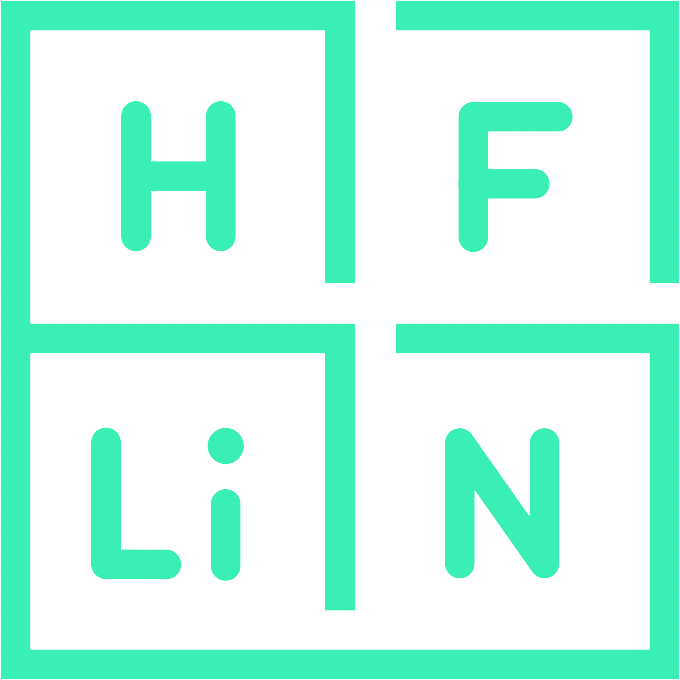
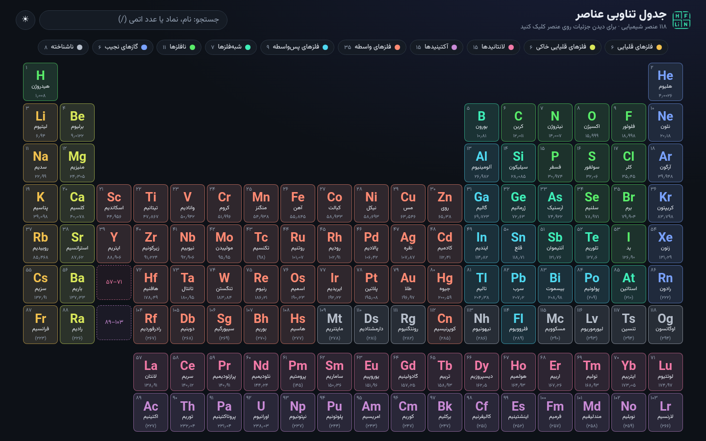
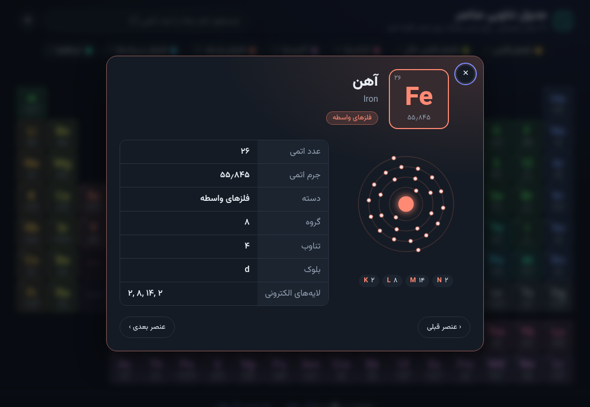

#  Periodic Table

An interactive **Persian (Farsi) periodic table of the elements**: all 118 elements with atomic number, atomic mass, category, group, period, block, electron shells and an animated Bohr model.

**Live demo:** <https://periodic.arash-hatami.ir>



| Element details | Mobile |
| --- | --- |
|  | The table keeps its shape and scrolls horizontally on small screens. |

## Features

- Full-width table that scales with the window and fits the viewport height on desktop
- Click (or press <kbd>Enter</kbd> on) any element for details and an animated Bohr model
- Navigate between elements with the on-screen buttons or the <kbd>←</kbd> / <kbd>→</kbd> keys
- Search by Persian name, English name, symbol or atomic number (press <kbd>/</kbd> to focus)
- Filter by category using the legend
- Dark and light themes (follows the OS, switchable, remembered)
- Deep links: `https://periodic.arash-hatami.ir/#Fe` opens iron
- Keyboard accessible, screen-reader labels in Persian, respects `prefers-reduced-motion`
- No build step, no dependencies, no runtime requests to third-party CDNs (the Vazirmatn font is self-hosted)

## Getting started

It is a static site. Serve the repository root with any web server:

```bash
python3 -m http.server 8000
# then open http://localhost:8000
```

Opening `index.html` directly from disk also works.

## Project structure

```text
.
├── index.html                 # Page shell (header, legend, empty table, dialog)
├── favicon.ico
├── CNAME                      # Custom domain for GitHub Pages
├── assets/
│   ├── css/
│   │   ├── tokens.css         # Colours, themes, category colour mapping
│   │   ├── base.css           # Reset, font-face, accessibility helpers
│   │   ├── layout.css         # Header, search, legend, buttons, footer
│   │   ├── table.css          # Element grid and cells
│   │   └── detail.css         # Detail dialog and Bohr model
│   ├── js/
│   │   ├── theme-init.js      # Applies the saved theme before first paint
│   │   ├── data/
│   │   │   ├── categories.js  # Category keys and Persian labels
│   │   │   └── elements.js    # The 118 elements (single source of truth)
│   │   ├── utils.js           # Persian digits, text normalisation, DOM helpers
│   │   ├── table.js           # Renders the grid, search and filtering
│   │   ├── detail.js          # Dialog + SVG Bohr model
│   │   └── app.js             # Wires everything together
│   ├── fonts/                 # Self-hosted Vazirmatn (SIL OFL)
│   ├── icons/                 # Favicons, web manifest, browserconfig
│   └── img/                   # Logo
└── docs/                      # Screenshots used in this README and social cards
```

Scripts are plain (non-module) files sharing a single `window.PT` namespace, so the site works from `file://` as well as from a server. Script order in `index.html` matters.

## Editing data

Everything shown comes from `assets/js/data/elements.js`. Each entry looks like:

```js
{ number: 26, symbol: "Fe", name: "Iron", nameFa: "آهن", mass: "55.845",
  category: "transition-metal", group: 8, period: 4, shells: [2, 8, 14, 2] }
```

- `mass` is a string; values in parentheses are the mass number of the most stable isotope.
- `group` is `null` for lanthanoids and actinoids, which are drawn in the two rows below the table.
- `shells` must add up to `number`.
- Grid position is derived from `group` and `period`, so there is no markup to edit by hand.

To add a category, add it to `categories.js` and give it a colour in `tokens.css` (both themes plus the `[data-category]` mapping).

## Contributing

Contributions are welcome.

1. Fork the repository
2. Create a branch: `git checkout -b feat/my-feature`
3. Commit using [Conventional Commits](https://www.conventionalcommits.org/): `git commit -m "feat: add something"`
4. Push the branch: `git push origin feat/my-feature`
5. Open a pull request

Found a wrong value, a typo in a Persian name, or a bug? Please [open an issue](https://github.com/hatamiarash7/Periodic-Table/issues).

## Support

[](https://en.cryptobadges.io/donate/3GhT2ABRuHuXGNzP6DH5KvLZRTXCBKkx2y) [](https://en.cryptobadges.io/donate/0x4832fd8e2cfade141dc4873cc00cf77de604edde)

[](https://ko-fi.com/D1D1WGU9)

<a href="https://payping.ir/@hatamiarash7"></a>

## License

[MIT](LICENSE). The bundled Vazirmatn font is licensed under the [SIL Open Font License](assets/fonts/OFL.txt).
